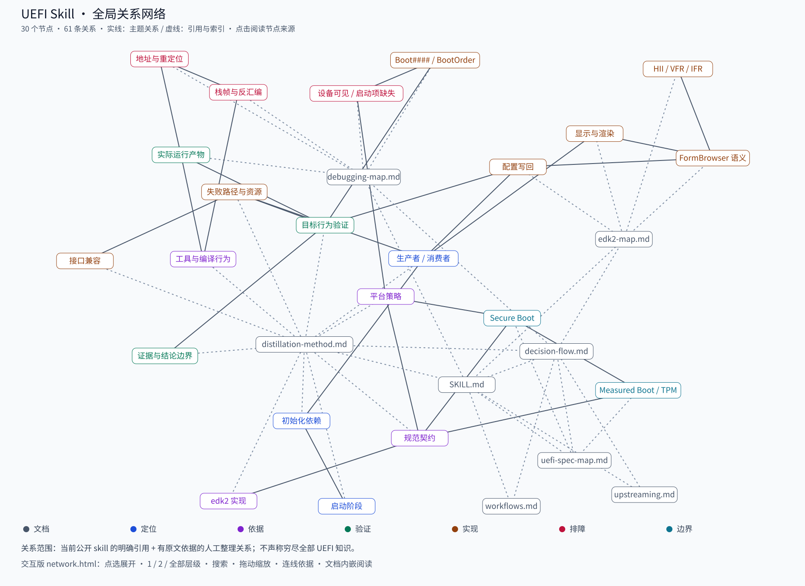
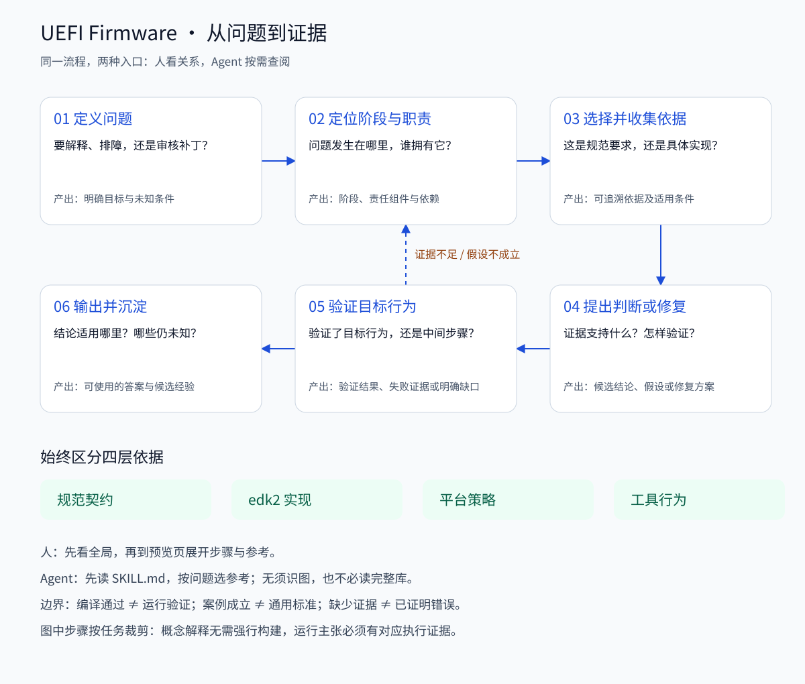

# UEFI Firmware Skill

A bilingual agent skill for UEFI firmware architecture, specifications, edk2
development, and debugging guidance.

This repository packages an installable UEFI Firmware Skill for AI agents, local
assistants, and firmware development workflows. It is intentionally broad enough
for UEFI/PI/edk2/HII/ACPI/SMBIOS/Secure Boot/QEMU questions, while keeping the
loaded skill small through reference files.

The skill includes a distilled reasoning reference for firmware work: classify
the phase, separate specification contracts from edk2 implementation details,
inspect source and logs before guessing, and keep compatibility evidence visible.

## Relationship Network / 单点展开的关系网



这张图展示全部已收录关系，不只是一条顺序流程。节点包括公开参考文档和经验主题；
关系分为文档引用、文档到主题索引、有原文依据的主题关系。不声称穷尽文档的所有隐含
含义或全部 UEFI 知识，也不包含本机私有笔记。

**Interactive / 交互版：** [network.html](skills/uefi-firmware/maps/network.html)
（GitHub 文件页显示源码；下载该 HTML 后用浏览器打开即可，无服务、无 CDN、无需配套文件。）

- 点击任意节点，展开一层、两层或全部连通关系；点击“全局关系”恢复全部节点。
- 搜索节点、按关系类型筛选、滚轮缩放、拖动空白平移、拖动节点调整布局。
- 点连线查看方向、含义和原文依据；原文已内嵌，可离线阅读。
- 展开使用双向邻接，目的是导航，不把相连路径自动当成因果链。

**Agent / 无需识图：** 先读 `SKILL.md` 的问题路由；需要探索关联时，读取
`maps/network.json` 或使用只读查询脚本：

```sh
python3 skills/uefi-firmware/scripts/query_network.py --search '启动项'
python3 skills/uefi-firmware/scripts/query_network.py --node boot --depth 2 --kind semantic
```

数据保留稳定节点 ID、关系类型、方向、来源路径、行号和原文摘录。它是当前 skill
的索引，不替代参考文档或对当前源码的验证。关键词查询不使用模型或语义检索服务。

**Maintenance / 更新：** 在 `maps/network-source.json` 编辑主题和带依据的关系；
文档之间的明确引用自动提取。模板在 `maps/network-template.html`。运行：

```sh
python3 skills/uefi-firmware/scripts/render_reasoning.py
python3 skills/uefi-firmware/scripts/render_network.py
python3 skills/uefi-firmware/scripts/render_network.py --check
python3 skills/uefi-firmware/scripts/test_network.py
```

生成器会检查来源摘录是否仍与文档一致；不再匹配时失败，而不是悄悄保留过期关系。

## Decision Flow / 顺序判断流程



先明确问题，定位阶段与职责，再选择依据、提出判断、验证目标；证据不足就返回定位。
这是一套可检查的工程决策流程，不是模型内部思维记录。

- **For humans / 人看图:** Open `skills/uefi-firmware/maps/preview.html` locally
  to expand each step and follow its reference links. The SVG above works without
  running a service.
- **For agents / Agent 读入口:** Start with `skills/uefi-firmware/SKILL.md` and
  choose references by question. Read `references/decision-flow.md` only when the
  full workflow is needed. Image recognition is not required.
- **For maintainers / 维护者:** Edit `skills/uefi-firmware/maps/reasoning.json`,
  then run `python3 skills/uefi-firmware/scripts/render_reasoning.py` to regenerate
  SVG, HTML, and the text workflow. The generator uses the Python standard library.

No database, hosted API, or vendor-specific agent runtime is needed to read this
skill. The diagrams explain the workflow; the references carry its detail and limits.

## Included Reasoning Reference / 推理参考

This skill includes a Nuwa-inspired distilled reasoning note in
`references/distillation-method.md`. It takes inspiration from
[alchaincyf/nuwa-skill](https://github.com/alchaincyf/nuwa-skill), but adapts one
reference method from personality/perspective distillation into domain-expert
firmware reasoning: phase-first classification, standards-boundary discipline,
source-first debugging, and evidence-based review.

The loaded `SKILL.md` contains the compact operating model; agents can load the
distilled reasoning reference only when needed. It presents transferable rules,
short examples, and explicit limits: choose evidence for the question, trace the
complete data path, fix the owning layer, verify the loaded artifact, test the
promised behavior, and keep conclusions within the evidence.

推理参考采用“通用规则 → 简短例子 → 结论边界”的结构。案例用于说明方法，
不把单个平台的实现或一次调试经验当成通用要求。

No vendor firmware assets or private documentation are included.

## Install

Use `skills/uefi-firmware/` as the installable skill directory. Any compatible
agent runtime can load the `SKILL.md` file and progressively read the reference
files as needed.

For Hermes Agent local installs, copy the full skill directory into your local
skills directory, then reload skills or restart Hermes:

```sh
mkdir -p ~/.hermes/skills
cp -R skills/uefi-firmware ~/.hermes/skills/
# In an active Hermes session, run /reload-skills if available; otherwise restart.
```

If your Hermes install uses a different skill directory, copy the entire
`skills/uefi-firmware/` directory there. Do not copy only `SKILL.md`; the
reference files are part of the skill.

For Codex-compatible environments:

```sh
python3 ~/.codex/skills/.system/skill-installer/scripts/install-skill-from-github.py \
  --repo MarsDoge/uefi-firmware-skill \
  --path skills/uefi-firmware
```

Restart the agent runtime after installation if it only loads skills at startup.

## What It Covers

- UEFI and PI architecture navigation
- edk2 package and build concepts
- HII, VFR, IFR, FormBrowser, and DisplayEngine relationships
- ACPI, SMBIOS, TCG/TPM, and Secure Boot orientation
- QEMU firmware debugging and serial-log triage
- Upstream-friendly firmware patch review and commit wording
- Firmware expert reasoning patterns included as a reusable reference

## What It Does Not Do

- It does not copy UEFI, PI, ACPI, SMBIOS, or TCG specifications.
- It does not replace platform documentation or source inspection.
- It does not encode vendor-private firmware behavior as standard behavior.
- It does not provide a complete UEFI tutorial book in the loaded skill body.

## Layout

```text
skills/uefi-firmware/
|-- SKILL.md
|-- agents/openai.yaml        # optional OpenAI/Codex-compatible metadata
|-- maps/                     # network + sequential flow, sources and generated views
|-- scripts/                  # generators, read-only graph query, regression tests
`-- references/
    |-- decision-flow.md      # generated text version of the sequential flow
    |-- debugging-map.md
    |-- distillation-method.md
    |-- edk2-map.md
    |-- uefi-spec-map.md
    |-- upstreaming.md
    `-- workflows.md
```

## Reference Files

- `references/workflows.md`: command-level templates for edk2 builds, source
  search, QEMU/OVMF debug, HII/VFR/IFR triage, and patch-review evidence.
- `references/uefi-spec-map.md`: official UEFI/PI/ACPI/SMBIOS/TCG/TPM and edk2
  documentation links plus standards-boundary guidance.
- `references/edk2-map.md`, `debugging-map.md`, `upstreaming.md`, and
  `distillation-method.md`: focused routing for implementation, debug, review,
  and reasoning behavior.

## Author

MarsDoge (Dongyan Qian)

## License

MIT
